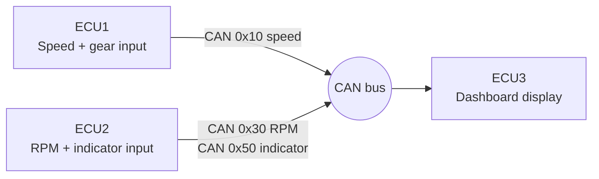

# CAN-Based Vehicle Dashboard

A vehicle dashboard built from **three PIC18F4580 microcontrollers (ECUs)** that
exchange data over a **CAN bus**. Two ECUs read inputs (speed, RPM, gear,
turn indicators) and a third ECU receives the messages and shows them on a
character LCD with indicator LEDs. Written in **Embedded C** with the
**MPLAB X IDE and XC8 compiler**.

## System overview



| ECU | Folder | Role |
|-----|--------|------|
| ECU1 | `ecu1.X/` | Reads a potentiometer on ADC channel 4 to compute vehicle speed and sends it on CAN (`0x10`). A 3-switch digital keypad on PORTC selects the gear (`ON`, `GN`, `G1`-`G5`, `GR`, `C_`). |
| ECU2 | `ecu2.X/` | Reads a potentiometer on ADC channel 4 to compute RPM and sends it on CAN (`0x30`). A 4-switch digital keypad selects the indicator state (`LEF`, `RIG`, `HAZ`, `OFF`), sent on CAN (`0x50`). |
| ECU3 | `ecu3.X/` | Receives all CAN messages and shows speed, gear, RPM and indicator state on the CLCD. Drives LEDs on RB0, RB1, RB6 and RB7 for left, right and hazard indication. |

See [docs/can_messages.md](docs/can_messages.md) for the full message table.

## Hardware

- 3 x PIC18F4580 (built-in ECAN module)
- CAN transceivers: [add model, e.g. MCP2551]
- 16x2 character LCD (CLCD) on ECU3
- Potentiometers for speed and RPM inputs (ADC channel 4)
- Digital keypad switches on ECU1 and ECU2
- Indicator LEDs on ECU3
- 20 MHz crystal (`_XTAL_FREQ 20000000`)

## Code structure

Each ECU is a separate MPLAB X project.

```
can-vehicle-dashboard/
├── ecu1.X/     speed + gear node  (main.c, ecu1.c, can.c, adc.c, dkp.c, clcd.c ...)
├── ecu2.X/     RPM + indicator node (main.c, ecu2.c, can.c, adc.c, dkp.c, ssd.c ...)
├── ecu3.X/     display node       (main.c, can.c, clcd.c ...)
└── docs/       CAN message table, photos, diagrams
```

Shared modules, used in each ECU where needed:

| File | Purpose |
|------|---------|
| `can.c / can.h` | ECAN setup (bit timing, operating mode), standard-ID transmit and receive on buffer 0 |
| `msg_id.h` | CAN message identifiers |
| `adc.c / adc.h` | 10-bit ADC read, right-justified |
| `dkp.c / digital_keypad.h` | Digital keypad scan with level and state-change detection |
| `clcd.c / clcd.h` | 16x2 character LCD driver |

ECU3's `can.c` sets the receive buffer to accept all messages
(`RXB0CONbits.RXM0 = RXM1 = 1`), so it can listen to every ID on the bus.

## Build and flash

1. Install **MPLAB X IDE** and the **XC8 compiler** (the projects were built with XC8 v3.10).
2. In MPLAB X, choose **File > Open Project** and open `ecu1.X`, `ecu2.X` and `ecu3.X`.
3. Build each project and program it onto its PIC18F4580.
4. Connect the three boards to the same CAN bus (CANH, CANL, common ground) with termination at both ends.

## Demo

[add a photo or a short video link of the working hardware]

## What I learned

- [add: configuring the PIC18F4580 ECAN module, bit timing and operating modes]
- [add: designing CAN message IDs and ASCII payloads for several nodes]
- [add: one debugging problem you solved while connecting the ECUs]
